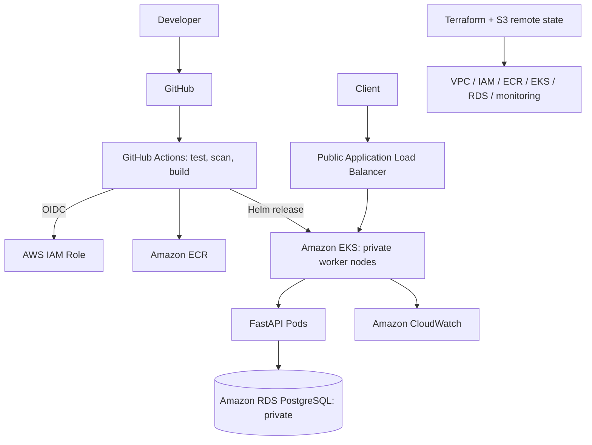

# CloudOps Infra

**AWS Infrastructure Automation & Kubernetes Application Delivery**

Infrastructure as Code, secure cloud networking, automated deployments, and operational visibility for a containerized order-management API.

> **Status:** Implementation in progress. The architecture below is the target design; operational results will be published only after verification.

## Problem & Solution

Manually configured cloud environments create deployment inconsistency, configuration drift, excessive access, and slow incident recovery. CloudOps Infra addresses these risks through Terraform-managed AWS infrastructure, versioned application releases, automated validation, and observable operations.

**Workload:** FastAPI order-management REST API with PostgreSQL persistence on Amazon RDS. The application will expose health checks and database-backed order operations to validate the deployment end to end.

## Architecture




**Network boundary:** Public ALB; private worker nodes and database; RDS access restricted to application traffic. Private connectivity, outbound access, encryption, and IAM permissions must be validated against the deployed configuration.

## Engineering Scope

| Capability | Implementation target |
| --- | --- |
| **AWS & Linux** | VPC, subnets, routing, IAM, private compute, DNS/TLS and Linux networking/process diagnostics |
| **Terraform** | Reusable modules, S3 remote state with locking, reviewed plans, environment isolation and drift detection |
| **Application & data** | FastAPI REST endpoints, PostgreSQL on RDS, migrations, API and integration tests |
| **Delivery** | Docker multi-stage build, ECR, GitHub Actions with OIDC, EKS and Helm rollout/rollback |
| **Security** | Least-privilege IAM, AWS Secrets Manager integration, Checkov IaC checks and Trivy image scanning |
| **Operations** | CloudWatch logs/alarms, Kubernetes probes, incident runbooks, cost alerts and teardown |

**Tooling decision:** GitHub Actions handles CI/CD; Helm manages Kubernetes releases. No Jenkins, Argo CD, or additional monitoring stack is required for this scope.

## Delivery Workflow

1. **Pull request:** Run application tests, Terraform formatting/validation, Checkov, and Helm lint.
2. **Approved merge:** Build a versioned Docker image, scan with Trivy, and publish to ECR using a commit-SHA tag.
3. **Deployment:** Assume a scoped AWS role through GitHub OIDC; deploy the approved image to EKS with Helm.
4. **Verification:** Check rollout, API responses, database connectivity, and CloudWatch telemetry.
5. **Recovery:** Revert an application release with Helm; handle database migration recovery separately.

> Pipeline stages are implementation targets until the corresponding workflow files and successful runs are available.

## Quick Start

**Prerequisites:** AWS account with a budget alert, Linux shell, Git, AWS CLI, Terraform, Docker, kubectl, Helm, and short-lived AWS credentials. EKS, NAT, ALB, and RDS can incur charges while running.

### 1. Clone and verify access

```bash
git clone https://github.com/RAJMORE19/cloudops-infra.git
cd cloudops-infra
aws sts get-caller-identity
terraform version
```

### 2. Bootstrap Terraform state

Before running the environment plan, create and configure the S3 backend and state-locking mechanism documented in `terraform/bootstrap/`. Use the backend configuration actually committed to the repository; never commit local state files or credentials.

### 3. Validate and provision AWS resources

```bash
cd terraform/environments/dev
terraform fmt -check -recursive
terraform init
terraform validate
terraform plan -out=tfplan
# Review resources, permissions, costs, and data-retention settings.
terraform apply tfplan
```

### 4. Connect to EKS and deploy

```bash
# Set these from verified Terraform outputs and your published ECR image.
export AWS_REGION="<region>"
export EKS_CLUSTER_NAME="<cluster-name>"
export ECR_IMAGE_URI="<account>.dkr.ecr.<region>.amazonaws.com/<repository>"
export IMAGE_TAG="<commit-sha>"

aws eks update-kubeconfig --region "$AWS_REGION" --name "$EKS_CLUSTER_NAME"
kubectl get nodes
cd ../../../
helm lint helm/order-api
helm upgrade --install order-api helm/order-api \
  --namespace order-api --create-namespace \
  --set-string image.repository="$ECR_IMAGE_URI" \
  --set-string image.tag="$IMAGE_TAG" \
  --wait --timeout 10m
kubectl rollout status deployment/order-api -n order-api
```

**Before deployment:** Publish the image to ECR, configure application secrets, and run required database migrations. The commands above become executable only after the referenced Terraform, Helm, and application files are implemented.

### 5. Verify the application

```bash
curl -fsS "https://<application-host>/health"
kubectl get pods,svc,ingress -n order-api
```

A successful health response is not sufficient evidence of database functionality. Validate an authenticated database-backed API operation and record the result.

## Verification & Evidence

| Engineering check | Acceptance criterion | Status |
| --- | --- | --- |
| Terraform reproducibility | Repeat plan reports no unexpected changes | Pending |
| AWS network isolation | Database has no public endpoint; access rules verified | Pending |
| CI/CD quality gate | Failing tests or scans block release | Pending |
| Application & database | API CRUD test persists data in RDS | Pending |
| Deployment & rollback | Healthy rollout and previous release restored | Pending |
| Monitoring & recovery | CloudWatch alarm and documented incident resolution | Pending |

### Deployment Evidence

Replace the placeholders below with **real, redacted screenshots** after successful validation. Keep credentials, account identifiers, tokens, and customer data out of images.

**01 — Terraform plan, apply, and drift check**

<!-- Add:  -->

**02 — GitHub Actions pipeline and ECR image**

<!-- Add:  -->

**03 — EKS workloads and API/database verification**

<!-- Add:  -->

**04 — CloudWatch alarm and recovery evidence**

<!-- Add:  -->

## Repository Layout

```text
cloudops-infra/
├── app/                    # FastAPI, tests, Dockerfile
├── terraform/
│   ├── bootstrap/          # Remote-state prerequisites
│   ├── environments/dev/   # Environment root module
│   └── modules/            # Reusable AWS modules
├── helm/order-api/         # Kubernetes release chart
├── .github/workflows/      # CI/CD and security checks
├── scripts/                # Operational validation helpers
├── docs/
│   ├── runbooks/           # Linux, AWS, Terraform and EKS incidents
│   ├── decisions/          # Architecture decisions and trade-offs
│   └── evidence/           # Verified screenshots and results
└── README.md
```

> Directory layout is the implementation target. Do not treat an uncommitted directory as available.

## Operational Notes

- **Linux troubleshooting:** Investigate DNS, routing, TLS, listening ports, CPU/memory, processes, and service logs; capture actual commands and findings in `docs/runbooks/`.
- **Terraform safety:** Review every plan; protect state, use locking, avoid secret outputs, and inspect drift before changes.
- **AWS security:** Prefer temporary credentials and GitHub OIDC; restrict security groups and workload IAM; keep secrets out of Git and container images.
- **Costs:** Set AWS Budgets alerts before provisioning. Review EKS, compute, NAT, ALB, RDS, and CloudWatch charges.
- **Teardown:** From `terraform/environments/dev`, review `terraform plan -destroy` before `terraform destroy`; preserve required snapshots and state-backend resources.

Detailed architecture decisions, bootstrap instructions, runbooks, and tested outcomes belong under `docs/` rather than expanding the project overview.

## License

MIT — see [LICENSE](LICENSE). The license link applies when the `LICENSE` file is committed.
